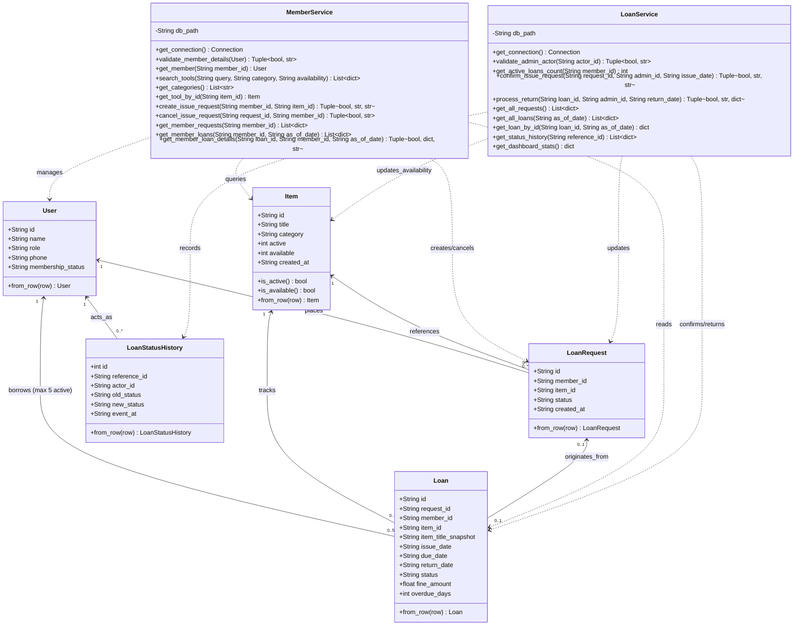

# Class Diagram — Tool Crib Management System
**Industry Use Case 49 | Software Engineering SAT II Assessment**  
**Institution:** Sri Eshwar College of Engineering  

---

## 1. Overview
The Class Diagram models the core domain entities, data attributes, service boundaries, business methods, and relationship multiplicities implemented in the system.

---

## 2. Mermaid Class Diagram

---

## 3. Class Attributes and Responsibilities Summary

1. **User**: Represents participants (Member, Admin). Enforces non-blank ID/name, exactly 10 digits for phone, and `ACTIVE` membership status.
2. **Item**: Master inventory record. Holds `active` flag (1=active, 0=inactive) and `available` flag (1=available, 0=unavailable).
3. **LoanRequest**: Pre-issue borrowing request. Status transitions: `REQUESTED` $\rightarrow$ `ISSUED` or `CANCELLED`.
4. **Loan**: Official loan record. Captures `item_title_snapshot` at issuance (BR4) to safeguard audit integrity against future master data renaming. Computes due date (`issue_date + 14 days`) and fine (`₹5 / overdue day`).
5. **LoanStatusHistory**: Immutable event log tracking every transition (`reference_id`, `actor_id`, `old_status`, `new_status`, `event_at`).
6. **MemberService**: Encapsulates all member operations, search filters, and strict ownership validation (`member_id` match required for data access).
7. **LoanService**: Encapsulates administrator operations, atomic issue confirmation transactions, 5-loan maximum check (BR1), single-return restoration guarantee (BR11), and fine calculation engine.
