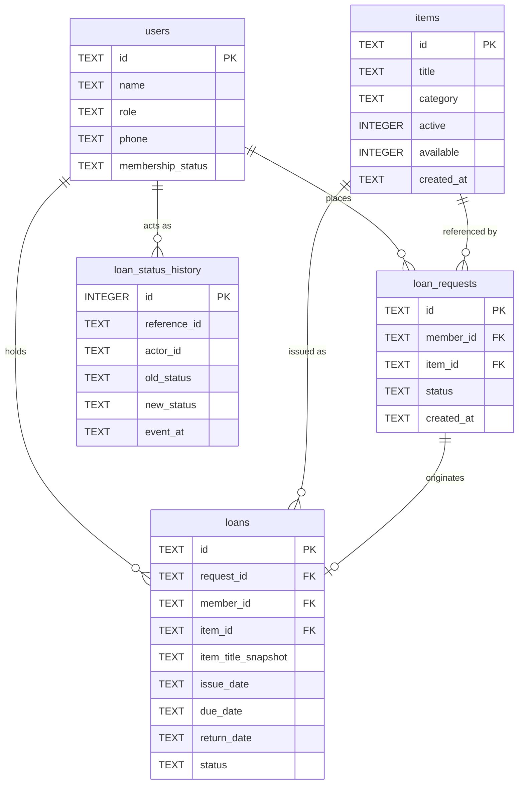

# Database Schema — Tool Crib Management System
**Industry Use Case 49 | Software Engineering SAT II Assessment**  
**Database Engine:** SQLite 3  
**Persistence:** Persistent file (`tool_crib.db`) with `PRAGMA foreign_keys = ON;`  

---

## 1. Entity-Relationship (ER) Overview

---

## 2. Table Specifications

### 2.1 Table: `users`
Stores user credentials and membership verification data for Members and Administrators.

| Column | Data Type | Constraints | Description |
|---|---|---|---|
| `id` | TEXT | PRIMARY KEY | Unique user identifier (e.g. `M101`, `M102`, `A101`). |
| `name` | TEXT | NOT NULL | Full name of the user. |
| `role` | TEXT | NOT NULL, CHECK(`role` IN ('Member', 'Admin')) | System access role. |
| `phone` | TEXT | NOT NULL | 10-digit mobile number (`^\d{10}$`). |
| `membership_status` | TEXT | NOT NULL, CHECK(`membership_status` IN ('ACTIVE', 'INACTIVE', 'SUSPENDED')) | Membership status. |

---

### 2.2 Table: `items`
Tool inventory catalog master table.

| Column | Data Type | Constraints | Description |
|---|---|---|---|
| `id` | TEXT | PRIMARY KEY | Tool identifier (e.g. `I101`, `I102`, `I103`, `I104`). |
| `title` | TEXT | NOT NULL | Descriptive name of the tool. |
| `category` | TEXT | NOT NULL | Tool classification category. |
| `active` | INTEGER | NOT NULL DEFAULT 1 CHECK(`active` IN (0, 1)) | 1 = Active, 0 = Inactive. |
| `available` | INTEGER | NOT NULL DEFAULT 1 CHECK(`available` IN (0, 1)) | 1 = Available, 0 = Currently Issued/Unavailable. |
| `created_at` | TEXT | NOT NULL | ISO-8601 registration timestamp (`YYYY-MM-DD HH:MM:SS`). |

---

### 2.3 Table: `loan_requests`
Queue of borrowing requests submitted by members.

| Column | Data Type | Constraints | Description |
|---|---|---|---|
| `id` | TEXT | PRIMARY KEY | Unique request identifier (e.g. `REQ-20261010-ABCD`). |
| `member_id` | TEXT | NOT NULL, FK $\rightarrow$ `users(id)` | ID of member creating the request. |
| `item_id` | TEXT | NOT NULL, FK $\rightarrow$ `items(id)` | ID of tool requested. |
| `status` | TEXT | NOT NULL, CHECK(`status` IN ('REQUESTED', 'ISSUED', 'CANCELLED', 'REJECTED')) | Current request status. |
| `created_at` | TEXT | NOT NULL | Timestamp of request creation. |

---

### 2.4 Table: `loans`
Active and historical loan records.

| Column | Data Type | Constraints | Description |
|---|---|---|---|
| `id` | TEXT | PRIMARY KEY | Unique loan identifier (e.g. `LN-20261010-WXYZ`). |
| `request_id` | TEXT | NULLABLE, FK $\rightarrow$ `loan_requests(id)` | Originating request ID (if applicable). |
| `member_id` | TEXT | NOT NULL, FK $\rightarrow$ `users(id)` | Borrower member identifier. |
| `item_id` | TEXT | NOT NULL, FK $\rightarrow$ `items(id)` | Current tool ID. |
| `item_title_snapshot`| TEXT | NOT NULL | Historical snapshot of tool title at time of issue (BR4). |
| `issue_date` | TEXT | NOT NULL | Issue date (`YYYY-MM-DD`). |
| `due_date` | TEXT | NOT NULL | Due date (`issue_date + 14 days`). |
| `return_date` | TEXT | NULLABLE | Actual date returned (`YYYY-MM-DD`), NULL while active. |
| `status` | TEXT | NOT NULL, CHECK(`status` IN ('ISSUED', 'RETURNED')) | Current loan status. |

---

### 2.5 Table: `loan_status_history`
Append-only immutable audit trail of all lifecycle status transitions.

| Column | Data Type | Constraints | Description |
|---|---|---|---|
| `id` | INTEGER | PRIMARY KEY AUTOINCREMENT | Monotonic log index. |
| `reference_id` | TEXT | NOT NULL | ID of affected entity (request ID or loan ID). |
| `actor_id` | TEXT | NOT NULL | ID of user who initiated the transition. |
| `old_status` | TEXT | NULLABLE | Previous status (`NULL` for creation). |
| `new_status` | TEXT | NOT NULL | Resulting status (`REQUESTED`, `ISSUED`, `CANCELLED`, `RETURNED`). |
| `event_at` | TEXT | NOT NULL | Event timestamp (`YYYY-MM-DD HH:MM:SS`). |

---

## 3. Transaction Safety and Integrity Guarantees

1. **Foreign Key Enforcement**: SQLite connection initialized with `PRAGMA foreign_keys = ON;`.
2. **Immediate Transactions**: All issue confirmations and return operations execute inside `cursor.execute("BEGIN IMMEDIATE")` transactions.
3. **Atomic Multi-Table Updates (BR9)**:
   - Tool issue atomically: inserts `loans` record, updates `loan_requests.status = 'ISSUED'`, updates `items.available = 0`, and inserts `loan_status_history`.
   - Tool return atomically: updates `loans.status = 'RETURNED'`, sets `loans.return_date`, restores `items.available = 1`, and inserts `loan_status_history`.
4. **Rollback on Invariant Failure**: Any validation error (limit reached, tool unavailable, invalid phone) immediately triggers `conn.rollback()` before returning an error message.
