# Use Case Diagram — Tool Crib Management System
**Industry Use Case 49 | Software Engineering SAT II Assessment**  
**Institution:** Sri Eshwar College of Engineering  

---

## 1. Actors
- **Member**: Engineering student, faculty member, or workshop technician requesting, borrowing, and returning tools.
- **Librarian / Administrator**: Tool crib manager responsible for verifying borrower credentials, confirming tool issues, processing returns, and auditing history.

---

## 2. Mermaid Use Case Diagram

```mermaid
graph TD
    %% Actors
    Member(["👤 Member"])
    Admin(["🛡️ Librarian / Administrator"])

    %% System Boundary
    subgraph ToolCribSystem ["Tool Crib Management System (Industry Use Case 49)"]
        %% Member Use Cases
        UC1(["UC-01: Select Role / Simulated Login"])
        UC2(["UC-02: Search & Browse Tools (FR1)"])
        UC3(["UC-03: Create Tool Issue Request (FR2)"])
        UC4(["UC-04: Cancel Own Issue Request (FR2)"])
        UC5(["UC-05: View Own Requests & Status (FR6)"])
        UC6(["UC-06: View Own Loan History & Fines (FR3, FR6)"])
        UC7(["UC-07: View Detailed Loan & Fine Calculation (FR3)"])

        %% Admin Use Cases
        UC8(["UC-08: View All Requests & Loans (FR7)"])
        UC9(["UC-09: Validate Member & Availability (FR4)"])
        UC10(["UC-10: Confirm Issue & Create Loan (FR5)"])
        UC11(["UC-11: Process Tool Return & Restore Availability (FR8)"])
        UC12(["UC-12: Inspect Audit Trail & Status History (FR10)"])

        %% Relationships & Includes
        UC10 -.-> |<<includes>>| UC9
        UC10 -.-> |<<includes>>| UC12
        UC11 -.-> |<<includes>>| UC12
    end

    %% Actor Connections
    Member --> UC1
    Member --> UC2
    Member --> UC3
    Member --> UC4
    Member --> UC5
    Member --> UC6
    Member --> UC7

    Admin --> UC1
    Admin --> UC8
    Admin --> UC10
    Admin --> UC11
    Admin --> UC12
```

---

## 3. Use Case Descriptions

| Use Case ID | Name | Actor | Description | Business Rules & Invariants |
|---|---|---|---|---|
| **UC-01** | Role Selection / Login | Member, Admin | Select synthetic identity or login. | Identifies session role and user ID. |
| **UC-02** | Search & Browse Tools | Member | Search tools by ID, name, category, and availability. | Displays active tools; indicates Available / Unavailable (FR1). |
| **UC-03** | Create Issue Request | Member | Request available tool for borrowing. | Validates tool is active & available; prevents duplicate requests (FR2, BR2). Max 5 active loans limit checked. |
| **UC-04** | Cancel Issue Request | Member | Cancel unconfirmed pending request. | Member may cancel only their own `REQUESTED` request (BR10, BR12). |
| **UC-05** | View Own Requests | Member | View list of submitted requests and status. | Member cannot see other members' requests (FR6). |
| **UC-06** | View Own Loans | Member | View active and returned loans. | Shows issue date, 14-day due date, return date, and fine status (FR3, FR6). |
| **UC-07** | View Loan Details | Member | Detailed loan snapshot & fine calculation. | Displays snapshot of tool title, countdown, and ₹5/day overdue fine (BR4, BR6). |
| **UC-08** | View All Requests & Loans | Admin | Monitor system-wide requests and loans. | Administrator oversight across all members (FR7). |
| **UC-09** | Validate Member & Tool | Admin | System checks prior to issue confirmation. | Member active, phone 10-digits, active loans < 5, tool active & available (FR4, BR1, BR7). |
| **UC-10** | Confirm Issue | Admin | Confirm valid request and create loan. | Creates `ISSUED` loan, snapshots tool title, sets 14-day due date, marks tool unavailable, logs history (FR5, BR9). |
| **UC-11** | Process Tool Return | Admin | Accept tool return from member. | Sets status `RETURNED`, records return date, restores availability to 1 exactly once, calculates fine (FR8, BR11). |
| **UC-12** | Inspect Audit Trail | Admin | Audit transition history. | Complete immutable log of all reference events (FR10). |
